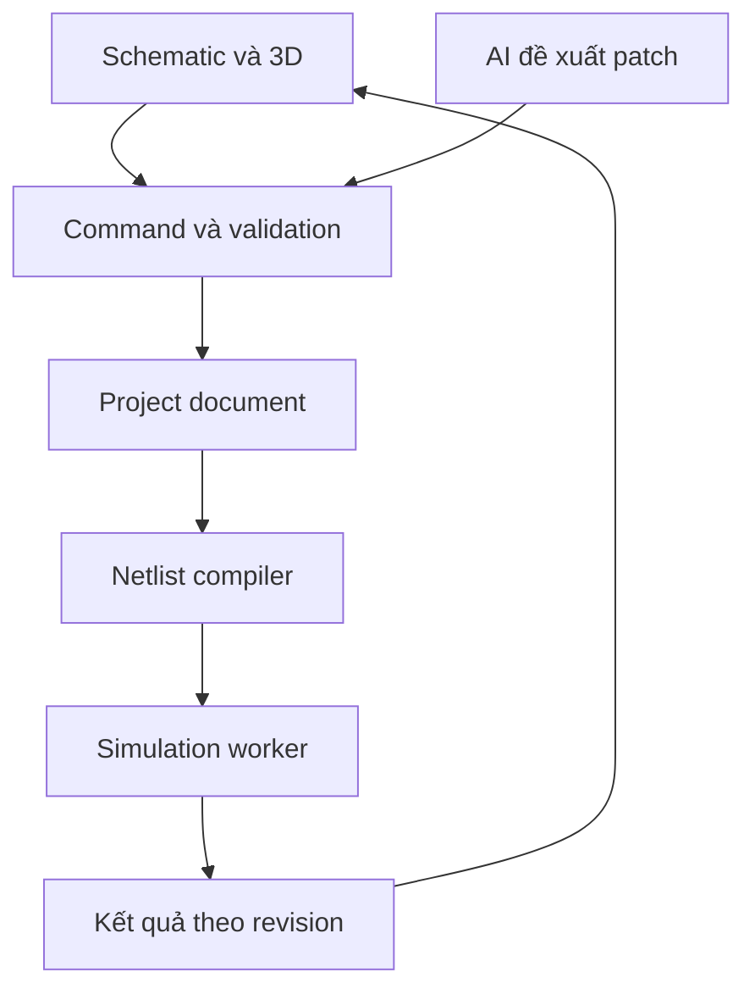

# NETLIST — Kế hoạch sản phẩm và kiến trúc triển khai

Phiên bản tài liệu: 1.0  
Ngày: 06/11/2026  
Trạng thái: Đặc tả khởi đầu; các công nghệ là lựa chọn đề xuất, cần kiểm chứng bằng prototype.  
Ngôn ngữ giao diện ban đầu: tiếng Việt, chuẩn bị sẵn cơ chế tiếng Anh.

## 1. Mục tiêu

Xây dựng phần mềm thiết kế điện tử trực quan, cho phép kéo thả linh kiện, nối dây, quan sát 3D, mô phỏng điện và cộng tác với AI trong cùng dự án.

Quy trình mục tiêu: mô tả yêu cầu → sơ đồ nguyên lý → lắp ráp 3D → kiểm tra → mô phỏng → chỉnh sửa → xuất dữ liệu. Ở giai đoạn nâng cao bổ sung PCB, firmware và kiểm tra với vỏ cơ khí.

Người dùng đầu tiên: người học điện tử, người làm DIY và kỹ sư cần thử ý tưởng mạch nhỏ. Không lấy thiết kế RF, điện công suất cao hoặc bo nhiều lớp phức tạp làm tiêu chí phiên bản đầu.

Nguyên tắc sản phẩm:
- Mỗi linh kiện và chân có danh tính ổn định giữa sơ đồ, 3D và mô phỏng.
- AI đề xuất thay đổi có thể xem trước, duyệt và hoàn tác.
- Bộ giải điện tính kết quả; AI hỗ trợ thiết kế và giải thích.
- Mạch vẫn chỉnh sửa, lưu và mô phỏng cục bộ được khi không kết nối AI.
- Phân biệt rõ: hiển thị 3D, kiểm tra quy tắc, mô phỏng và kết quả đo thực tế.

## 2. Có thể mô phỏng những gì?

Có. Dùng bộ mô phỏng điện chuyên dụng và ánh xạ kết quả sang giao diện 2D/3D.

| Nhóm | Khả năng mục tiêu | Phạm vi |
|---|---|---|
| Analog DC | Điện áp nút, dòng nhánh, điểm làm việc | MVP |
| Analog transient | Tụ nạp/xả, dạng sóng theo thời gian, LED qua điện trở | MVP |
| Analog AC | Đáp ứng biên độ/pha tín hiệu nhỏ quanh điểm làm việc | Sau MVP |
| Logic số | Cổng logic, clock, bộ đếm | Giai đoạn 2 |
| Vi điều khiển | Chạy firmware trên tập thiết bị được hỗ trợ | Giai đoạn 3, cần emulator riêng |
| Analog + số | Cầu nối ADC/DAC và đồng bộ thời gian | Giai đoạn nâng cao |
| Nhiệt, EMI, RF, cơ học | Cần solver và mô hình chuyên biệt | Ngoài MVP |

Không cam kết mọi linh kiện trong thư viện đều mô phỏng được. Mỗi linh kiện phải hiển thị trạng thái: chỉ hiển thị / có mô hình điện / đã kiểm chứng trong phạm vi cụ thể.

### 2.1 Bộ giải đề xuất

Dùng ngspice cho analog. Tài liệu chính thức có giao diện shared library; prototype ban đầu nên chạy CLI trong tiến trình riêng để giảm độ phức tạp và cô lập lỗi. Chỉ chuyển sang shared library khi có nhu cầu điều khiển hoặc truyền dữ liệu phù hợp đã được đo.

Đối với số: cân nhắc engine sự kiện cho tập cổng cơ bản; Verilator phù hợp khi cần mô hình HDL được hỗ trợ. Verilator không tự cung cấp emulator cho mọi vi điều khiển hoặc mô hình analog bất kỳ.

Đối với MCU: chọn đúng một dòng MCU sau khi đánh giá bộ lệnh, ngoại vi, giấy phép và độ chính xác; không đưa lời hứa hỗ trợ Arduino/ESP32/STM32 đầy đủ vào MVP.

### 2.2 Hoạt động trong 3D

- LED: độ sáng được ánh xạ từ dòng điện bằng đường cong hiển thị đã định nghĩa; đây là minh họa, không phải mô phỏng quang học chính xác.
- Dây: tô màu theo điện áp, cho phép bật/tắt và hiển thị thang màu.
- Probe: chọn chân hoặc net để mở waveform, giá trị và đơn vị.
- Công tắc: thay đổi trạng thái bằng thao tác người dùng; MVP có thể chạy lại mô phỏng từ đầu sau thay đổi.
- Motor, màn hình, relay: chỉ có hoạt ảnh khi mô hình hành vi tương ứng tồn tại; không suy ra trạng thái tùy ý từ hình 3D.
- Nhiệt: chỉ hiện công suất tổn hao nếu tính được; không gọi đó là bản đồ nhiệt độ khi chưa có mô hình nhiệt.

## 3. Phạm vi phiên bản đầu

### Bắt buộc

1. Tạo, mở, lưu dự án và tự khôi phục bản nháp.
2. Thư viện nhỏ được kiểm chứng: nguồn DC, ground, điện trở, tụ, diode, LED, công tắc và breadboard.
3. Sơ đồ nguyên lý 2D: kéo thả, xoay, nối dây, junction, nhãn net.
4. Không gian 3D: kéo thả, bắt dính chân, dây trực quan, xoay/zoom và chọn đối tượng.
5. Đồng bộ kết nối 2D/3D qua dữ liệu điện chung.
6. Kiểm tra đầu nối, giá trị, ground và mô hình trước khi chạy.
7. Mô phỏng DC/transient bằng ngspice; biểu đồ và probe.
8. Một adapter AI đầu tiên, kiến trúc cho phép thêm nhà cung cấp.
9. AI tạo patch có thể duyệt; undo/redo cho mọi thay đổi thiết kế.
10. Xuất GLB, PNG, BOM CSV và netlist SPICE trong tập tính năng hỗ trợ.

### Chưa đưa vào MVP

- PCB editor hoàn chỉnh, autorouter, Gerber hoặc Pick and Place.
- Chuyển breadboard sang PCB một lần nhấp với kết quả sẵn sản xuất.
- STEP chất lượng cơ khí từ mọi mô hình mesh.
- Chạy firmware mọi MCU, mô phỏng điện từ hoặc nhiệt đầy đủ.
- Cộng tác nhiều người thời gian thực và marketplace.
- Đọc ảnh để khôi phục chính xác mọi mạch.

## 4. Trải nghiệm người dùng

### 4.1 Bố cục

| Vùng | Chức năng |
|---|---|
| Trái | Cây dự án, thư viện, tìm linh kiện |
| Trung tâm | Schematic, Breadboard 3D; hỗ trợ chia đôi |
| Phải | Thuộc tính, chân, mô hình, AI và patch |
| Dưới | Waveform, lỗi kiểm tra, nhật ký mô phỏng |
| Thanh trên | Lưu, undo/redo, kiểm tra, chạy/dừng, xuất |

### 4.2 Kéo thả 3D

- Hiện bóng xem trước trước khi đặt; Escape hủy.
- Chọn mặt phẳng đặt và grid, không để raycast chọn nhầm mặt sau.
- Bắt dính dựa vào khoảng cách và tính tương thích chân/lỗ.
- Đặt DIP vào breadboard theo khoảng cách chân và vị trí rãnh giữa.
- Mô hình breadboard chứa nhóm lỗ nối chung; ray nguồn có thể bị chia đoạn theo loại breadboard.
- Di chuyển chỉ thay đổi vị trí. Thao tác cắm/rút mới thay đổi kết nối vật lý; luôn xem trước các net bị ảnh hưởng.
- Dây có endpoint theo pin ID hoặc hole ID; đường cong 3D chỉ là cách hiển thị.
- Dây đi qua nhau không tự tạo kết nối. Junction phải là thao tác rõ ràng.
- Giữ phím hoặc dùng thanh công cụ để xoay; hỗ trợ chuột và bàn phím.
- Thông báo lý do khi không cắm được chân, không tự bóp méo kích thước linh kiện.

### 4.3 Chính sách đồng bộ

Schematic và breadboard cùng tham chiếu mạch điện, nhưng một linh kiện schematic mới có thể chưa được đặt vật lý. Hiển thị “chưa đặt” và “chưa nối vật lý” riêng.

Thay đổi kết nối ở một view phải được chuyển thành command thay đổi đồ thị điện; view còn lại cập nhật từ command đó. Không tự động tạo đường dây vật lý hoàn chỉnh cho mọi kết nối schematic: đưa vào danh sách cần bố trí.

Có trạng thái triển khai vật lý chưa khớp mạch; người dùng phải thấy các sai khác. Không xuất thông báo “hoàn tất lắp ráp” khi còn thiếu kết nối.

## 5. Kiến trúc đề xuất

### 5.1 Stack khởi đầu

| Lớp | Đề xuất | Lý do |
|---|---|---|
| Desktop shell | Electron | Thuận tiện cho tiến trình mô phỏng cục bộ; ưu tiên Windows trước |
| UI | React + TypeScript | Dùng chung kiểu dữ liệu và component |
| Schematic | SVG cho prototype | Dễ chọn, chỉnh sửa và kiểm chứng; đánh giá Canvas khi có số liệu hiệu năng |
| 3D | Three.js | Cảnh 3D và xuất GLB/glTF |
| Core | TypeScript thuần | Graph, command, validation không phụ thuộc UI |
| Simulation worker | Tiến trình ngspice riêng | Cô lập bộ giải khỏi UI |
| Biểu đồ | Thư viện hỗ trợ nhiều điểm và decimation | Chọn sau benchmark nhỏ |
| AI gateway | Main process/tiến trình dịch vụ | Giữ API key ngoài renderer |
| Dự án | ZIP có manifest JSON và assets | Di chuyển được, có schema version |
| Kiểm tra | Vitest + kiểm thử tích hợp desktop | Kiểm chứng graph, compiler và workflow |

Đây là lựa chọn kiến trúc, chưa phải kết quả benchmark. Cần spike xác nhận đóng gói ngspice trên Windows trước khi cam kết stack cuối cùng. Khóa phiên bản dependency sau spike; không dùng nhãn latest trong build phát hành.

### 5.2 Luồng dữ liệu



Các lớp hiển thị chỉ đọc dữ liệu hoặc gửi command; không tự ghi graph. AI sử dụng cùng command API với người dùng.

## 6. Mô hình dữ liệu

### 6.1 Thực thể chính

| Thực thể | Nội dung |
|---|---|
| ComponentDefinition | Tên, loại, schema tham số, chân logic, model và nguồn gốc |
| ComponentInstance | ID, reference R1/C1, definition version, giá trị |
| Pin | ID ổn định trong definition, tên, số chân, electrical type |
| Net | ID và tập endpoint điện |
| SchematicPlacement | Instance ID, tọa độ, góc xoay và đường wire |
| AssemblyPlacement | Instance ID, transform 3D và vị trí cắm |
| BreadboardDefinition | Lỗ, nhóm dẫn điện nội bộ, tọa độ và pitch |
| SimulationProfile | Kiểu phân tích, thời gian, tolerance và probe |
| SimulationRun | Snapshot hash, solver version, model hashes, log, kết quả |
| ChangeSet | Base revision, operations, nguồn người/AI, lý do |
| Asset | URI nội bộ, hash, đơn vị, giấy phép và nguồn |

### 6.2 Quy ước

- UUID cho instance/net; reference dễ đọc không dùng làm ID.
- Lưu giá trị điện bằng SI; tách chuỗi hiển thị và giá trị đã parse.
- Chuẩn hóa đơn vị và tiền tố; SPICE có quy ước riêng, compiler phải chuyển rõ ràng thay vì ghép chuỗi người dùng.
- Pin mapping là ánh xạ rõ ràng giữa chân logic, symbol, footprint, anchor 3D và thứ tự model SPICE.
- Net ground biên dịch thành node 0; không tự gán một net bất kỳ làm ground.
- Kết quả cũ trở thành stale khi graph hoặc model thay đổi.
- Vị trí 3D lưu bằng mm trong document; adapter renderer đổi sang m để xuất glTF đúng tỷ lệ.
- Model có anchor/orientation chuẩn; không đoán chân từ bounding box.

### 6.3 Ví dụ document tối giản

```json
{
  "schemaVersion": 1,
  "projectId": "project-example",
  "revision": 1,
  "components": [
    {"id":"v1","ref":"V1","definition":"dc-source@1","params":{"voltageV":5}},
    {"id":"r1","ref":"R1","definition":"resistor@1","params":{"resistanceOhm":1000}},
    {"id":"r2","ref":"R2","definition":"resistor@1","params":{"resistanceOhm":1000}}
  ],
  "nets": [
    {"id":"vin","endpoints":["v1:p","r1:1"]},
    {"id":"out","endpoints":["r1:2","r2:1"]},
    {"id":"gnd","isGround":true,"endpoints":["v1:n","r2:2"]}
  ],
  "simulation":{"analysis":"op"}
}
```

Đây là ví dụ minh họa để xây schema chính thức, không phải API đã triển khai.

## 7. Pipeline mô phỏng

1. Chụp snapshot bất biến của revision hiện tại.
2. Kiểm tra schema, giá trị, pin mapping và model.
3. Tạo graph kết nối từ net, junction và nhóm lỗ breadboard.
4. Chuẩn hóa node, giữ bảng ánh xạ ngược sang đối tượng UI.
5. Biên dịch SPICE bằng template tin cậy; không nhận raw command từ AI.
6. Chạy solver trong workspace tạm riêng, có timeout và giới hạn tài nguyên.
7. Thu log, nhận diện lỗi cú pháp, hội tụ và thiếu model.
8. Parse kết quả thành vector có tên, đơn vị và trục thời gian.
9. Gắn kết quả với snapshot/model/solver version.
10. Phát dữ liệu xuống waveform và 3D; giữ dữ liệu đầy đủ để đo.

### 7.1 Trạng thái chạy

`idle → validating → queued → running → completed | failed | cancelled`

Sau chỉnh sửa, trạng thái kết quả hiển thị thêm stale. Hủy phải dừng tiến trình con, dọn workspace và không nhận nhầm dữ liệu đến muộn.

MVP chạy theo batch; nút Play là phát lại dữ liệu đã tính. Không gọi đó là solver thời gian thực. Muốn thay đổi tham số trong lúc chạy phải có thiết kế đồng bộ riêng.

### 7.2 Bài thử điện chuẩn đầu tiên

```spice
Netlist voltage divider acceptance fixture
V1 vin 0 DC 5
R1 vin out 1k
R2 out 0 1k
.op
.end
```

Kỳ vọng: V(out) = 2,5 V và dòng qua mỗi điện trở có độ lớn 2,5 mA. Kiểm tra dấu dòng nguồn theo quy ước SPICE. Sai số cho fixture tuyến tính này: tối đa 1e-6 V tại đầu ra trong môi trường kiểm thử đã khóa.

Bài transient RC: R=1 kΩ, C=1 µF, hằng số thời gian 1 ms. Dùng nguồn bước với thời gian sườn hữu hạn và điều kiện ban đầu rõ ràng; tại một hằng số thời gian sau bước, điện áp đạt xấp xỉ 63,2% mức cuối. Chọn bước lấy mẫu đủ nhỏ, dung sai nghiệm thu 1% mức cuối; không dùng nguồn DC đã ổn định rồi kỳ vọng thấy tụ nạp.

### 7.3 Trình bày kết quả

- Crosshair, zoom, bật/tắt trace và xuất CSV waveform.
- Probe dòng gắn chiều tham chiếu rõ ràng.
- Hiện simulated time khác wall-clock time.
- Render 3D lấy mẫu nội suy theo timeline, không dùng FPS làm bước solver.
- Decimate cho hiển thị; không làm mất dữ liệu gốc dùng để đo.
- Lỗi hội tụ là lỗi có thể chẩn đoán, không tự diễn giải thành mạch đúng hoặc sai.

## 8. Kiểm tra trước khi chạy

Phân loại error, warning và thông tin; mọi lỗi trỏ về đối tượng.

Error: thiếu model bắt buộc, pin mapping không hợp lệ, giá trị không parse được, net endpoint không tồn tại, profile sai.

Warning: chân để hở, nguồn xung đột theo quy tắc, model chỉ đúng trong khoảng xác định, lắp ráp vật lý chưa khớp schematic.

Kiểm tra thiếu ground có xét cấu trúc mạch và yêu cầu solver. ERC không thay thế phân tích điện, và không khẳng định an toàn thực tế.

## 9. AI tích hợp

### 9.1 Các tính năng

- Giải thích vùng mạch được chọn.
- Đề xuất mạch từ yêu cầu và chỉ dùng linh kiện/model có trong thư viện.
- Chỉnh giá trị, thêm linh kiện và nối net bằng patch.
- Giải thích kết quả dựa vào run cụ thể, trích giá trị và đơn vị.
- Tóm tắt datasheet với trang dẫn nguồn ở giai đoạn sau.

### 9.2 Hợp đồng adapter

```ts
interface AIProvider {
  id: string;
  capabilities: {
    images: boolean;
    structuredOutput: boolean;
    toolCalling: boolean;
  };
  propose(input: DesignContext, signal: AbortSignal): Promise<DesignProposal>;
}
interface DesignProposal {
  baseRevision: number;
  explanation: string;
  assumptions: string[];
  operations: DesignOperation[];
}
```

Model ID, endpoint và giới hạn chi phí là cấu hình, không hardcode tên “AI mới nhất”. Adapter đầu tiên được chọn khi triển khai dựa trên quyền truy cập và yêu cầu dữ liệu. Thêm provider thứ hai sau khi hợp đồng adapter đã ổn định.

### 9.3 Quy trình patch

AI → validate JSON/schema → kiểm tra ID và đơn vị → tạo preview → người dùng duyệt → kiểm tra baseRevision → commit nguyên tử → ERC → tùy chọn mô phỏng lại.

Patch lệch revision phải bị từ chối hoặc rebase có xem trước; không âm thầm áp lên mạch mới. Duyệt một phần chỉ khi dependency giữa operations được giải quyết.

AI không được thực thi shell, tự cài dependency, ghi đường dẫn tùy ý hoặc sửa raw project ngoài command API. Nội dung datasheet được xử lý như dữ liệu tham khảo. API key giữ trong kho bí mật của hệ điều hành; tắt nodeIntegration và bật contextIsolation cho Electron renderer, IPC có allowlist và validation.

## 10. Lưu dự án và phục hồi

Đề xuất phần mở rộng `.netlistproj`, thực chất là ZIP:

```text
project.json
library/definitions.json
assets/models/*.glb
models/spice/*
views/schematic.json
views/assembly.json
simulations/profiles.json
results/manifest.json
```

Kết quả lớn có thể bỏ khỏi gói theo lựa chọn nhưng phải giữ metadata. Gói mặc định tự chứa asset cần thiết; reference ngoài phải được báo rõ. Không đóng gói khóa API.

Lưu nguyên tử qua file tạm; autosave riêng, không ghi đè bản đã lưu khi chưa hoàn tất. Migration theo schemaVersion có backup. Chặn ZIP path traversal, kiểm tra kích thước giải nén, hash asset và file model ngoài phạm vi cho phép.

Undo/redo dựa trên command transaction; việc kéo dài một lần chỉ tạo một mục lịch sử. Reload phải giữ nguyên ID và connectivity.

## 11. Xuất dữ liệu

| Định dạng | Giai đoạn | Tiêu chí |
|---|---|---|
| Dự án | MVP | Mở lại, sửa và chạy lại được |
| GLB | MVP | Đúng tỷ lệ, transform, màu và đối tượng cần xuất |
| PNG | MVP | Chọn góc nhìn, độ phân giải, tùy chọn nền |
| BOM CSV | MVP | Reference, giá trị, loại, số lượng; CSV escaping đúng |
| SPICE netlist | MVP | Chỉ xuất tập model được hỗ trợ; kèm model và nguồn khi được phép |
| Waveform CSV | MVP | Trục, đơn vị và metadata run |
| STEP | Nâng cao | Cần B-rep/CAD backend và model cơ khí phù hợp |
| Gerber + drill | Sau PCB editor | Phải có board stackup, pad, track, outline và DRC |
| Pick and Place | Sau PCB editor | Kiểm chứng origin, mặt bo, đơn vị và quy ước góc |

GLB là mô hình xem, không phải hồ sơ chế tạo. STL/3MF chỉ phù hợp chi tiết cơ khí khi có hình học đáp ứng yêu cầu. Không đổi tên mesh thành STEP để tuyên bố hỗ trợ CAD.

## 12. Cấu trúc repository đề xuất

```text
netlist/
  apps/desktop/           # Electron main, preload, cửa sổ
  apps/editor/            # React UI
  packages/core/          # Document, graph, command, undo
  packages/schema/        # Validation, migrations
  packages/schematic/     # Editor 2D
  packages/assembly-3d/   # Scene, picking, snap, wire
  packages/library/       # Definition, mapping và assets
  packages/netlist/       # Compiler SPICE
  packages/simulation/    # Worker protocol, runner, parser
  packages/ai/            # Adapter, context, patch validation
  packages/export/        # GLB, CSV, ảnh, project
  fixtures/circuits/      # Mạch nghiệm thu
  fixtures/models/        # Model đã kiểm tra nguồn và giấy phép
  tests/integration/
  docs/adr/               # Quyết định kiến trúc
  docs/                   # Hướng dẫn dùng và phát triển
```

Dùng workspace package manager, lockfile và CI. UI không import trực tiếp native solver. Core không phụ thuộc Three.js hoặc Electron.

## 13. Hợp đồng simulation worker

Request: runId, projectRevision, snapshotHash, analysis, solverSettings, generatedNetlistPath và model manifest đã kiểm chứng.

Event: started, progress nếu engine cung cấp, log, resultChunk, completed, failed, cancelled. Mọi event có runId; result chứa vector name, unit và axis.

Không giả lập phần trăm tiến độ khi engine không cung cấp. Frontend bỏ event của run bị hủy hoặc snapshot không còn phù hợp. File đường dẫn chỉ do main process cấp, không lấy trực tiếp từ nội dung AI.

## 14. Backlog và tiêu chí nghiệm thu

| ID | Công việc | Hoàn thành khi |
|---|---|---|
| N01 | Core schema + graph | Tạo mạch chia áp bằng dữ liệu, serialize round-trip |
| N02 | Command/undo | Add, move, connect, delete hoàn tác đúng net |
| N03 | Schematic | Vẽ fixture chia áp và có junction rõ ràng |
| N04 | SPICE compiler | Cùng snapshot tạo output xác định, mapping ngược đúng |
| N05 | Solver runner | DC đúng, hủy/timeout và lỗi không treo UI |
| N06 | Waveform | RC đúng nghiệm thu, đơn vị và cursor chính xác |
| N07 | 3D placement | Kéo linh kiện, snap chân và xoay đúng |
| N08 | Breadboard graph | Nhóm lỗ nối chung đúng; ray chia đoạn đúng |
| N09 | Đồng bộ | Chọn và sửa kết nối phản ánh ở hai view |
| N10 | AI patch | Preview, reject, accept, stale revision, undo đúng |
| N11 | Save/export | Reload giữ kết nối, GLB đúng scale, BOM đúng |
| N12 | Desktop release | Máy Windows sạch mở app và chạy fixture không cần tự cài solver |

## 15. Lộ trình tham chiếu

Ước lượng cho nhóm nhỏ khoảng 3 người có kinh nghiệm full-stack/đồ họa/điện tử; không phải cam kết thời hạn. Người làm một mình cần chia nhỏ và điều chỉnh theo spike.

| Chặng | Thời gian dự kiến | Kết quả |
|---|---|---|
| 0. Spike kỹ thuật | 1–2 tuần | ngspice đóng gói, compiler fixture, kéo thả 3D thử nghiệm |
| 1. Core và schematic | 2–3 tuần | Schema, graph, undo, mạch 2D lưu được |
| 2. Mô phỏng | 2–3 tuần | DC/transient, log, waveform, hủy và stale result |
| 3. Lắp ráp 3D | 3–4 tuần | Breadboard, anchor, snap, kết nối đồng bộ |
| 4. AI và xuất | 2–3 tuần | Một provider, patch duyệt được, GLB/BOM |
| 5. Hoàn thiện bản alpha | 2–3 tuần | Installer, recovery, hướng dẫn và nghiệm thu |

Sau alpha mới quyết định đầu tư PCB editor, MCU hay giáo dục theo phản hồi người dùng. Không triển khai cả ba nhánh đồng thời ngay từ đầu.

## 16. Kế hoạch 10 ngày khởi động

1. Ngày 1: tạo repository, ghi ADR cho desktop/local-first, chọn giấy phép mã dự án và xác nhận cách phân phối dependency.
2. Ngày 2: schema document, component/pin/net và fixture chia áp.
3. Ngày 3: compiler SPICE, pin mapping, kiểm thử giá trị và đơn vị.
4. Ngày 4: runner DC, parse kết quả, log và timeout.
5. Ngày 5: transient RC và waveform đơn giản.
6. Ngày 6: canvas schematic tối thiểu, chọn và di chuyển điện trở.
7. Ngày 7: nối dây, union connectivity, undo và save/load.
8. Ngày 8: scene 3D, camera, raycast và model điện trở có anchor.
9. Ngày 9: breadboard tối giản, snapping và xác nhận kết nối.
10. Ngày 10: demo xuyên suốt, ghi lỗi, đo hiệu năng và quyết định tiếp tục.

Mục tiêu 10 ngày là chứng minh chuỗi dữ liệu và bộ giải hoạt động; chưa phải sản phẩm hoàn chỉnh.

## 17. Kiểm chứng chất lượng

### Điện và dữ liệu

- Chia áp và RC theo fixture ở mục 7.
- Diode/LED: dùng model có phiên bản cố định, so sánh với kết quả ngspice độc lập; không đặt một điện áp thuận cố định cho mọi LED.
- Nối/tách net, junction, delete và undo không làm mất endpoint.
- Đổi ref không đổi danh tính; di chuyển hình không tự thay đổi kết nối.
- Breadboard có fixture cả nhóm lỗ thường, ray liền và ray đứt đoạn.

### Tích hợp

- Thiếu model, net lỗi, nguồn xung đột, timeout và hủy.
- Sửa mạch khi chạy: kết quả cũ không ghi đè trạng thái hiện tại.
- AI trả schema sai hoặc reference không tồn tại: từ chối, mạch giữ nguyên.
- Save/load và migration bảo toàn mạch.
- File GLB mở được bằng viewer độc lập; vật thể 100 mm xuất thành 0,1 m.
- Installer chạy fixture trên máy sạch.

### Hiệu năng mục tiêu ban đầu

Benchmark được đo trên máy tham chiếu công bố sau spike: Windows 11, RAM 16 GB, GPU tích hợp có WebGL2. Cảnh thử 100 linh kiện đơn giản và 200 dây, có khai báo polygon budget.

Mục tiêu thao tác thông thường phản hồi dưới 100 ms và orbit trung vị đạt 30 FPS trở lên; báo thêm p95 frame time. Đây là mục tiêu nghiệm thu cần đo, chưa phải khả năng đã xác nhận. Thời gian solver phụ thuộc mạch; không cam kết mọi mạch chạy nhanh hơn thời gian thực.

## 18. Rủi ro và cách xử lý

| Rủi ro | Cách xử lý |
|---|---|
| Model sai chân hoặc sai tham số | Fixture theo linh kiện, pin mapping tường minh |
| Phạm vi 3D và PCB quá lớn | Breadboard trước, PCB sau |
| AI tạo mạch sai | Patch có duyệt, ERC và mô phỏng, giữ giả định |
| Mô phỏng không hội tụ | Hiện log, hướng dẫn chẩn đoán, không tự sửa âm thầm |
| Solver crash | Worker riêng, timeout, khôi phục UI |
| Asset/model hạn chế phân phối | Lưu license/source/version; thay model khi không đủ quyền |
| MCU thiếu ngoại vi | Công bố support matrix theo chip và ngoại vi |
| Đồng bộ 2D/3D lệch | Core graph chung, trạng thái chưa bố trí rõ ràng |
| Người dùng nhầm hiển thị với xác nhận điện | Gắn nhãn khả năng và nguồn kết quả |

Trước phát hành cần lập bảng giấy phép của code, ngspice, model SPICE và asset 3D thực tế được đóng gói. Chưa kết luận quyền phân phối chỉ dựa vào việc tài liệu tải được trên mạng.

## 19. Các quyết định đã chọn cho bản khởi đầu

- Desktop Windows trước, kiến trúc mở đường cho nền tảng khác.
- Local-first; chưa cần tài khoản hoặc backend cloud cho thao tác cơ bản.
- Schematic + breadboard 3D; PCB ở giai đoạn sau.
- ngspice analog batch, DC và transient trước.
- Một AI provider trước, adapter mở rộng về sau.
- Thư viện nhỏ có model và pin mapping kiểm chứng.
- Xuất dự án, GLB, PNG, BOM và SPICE theo phạm vi hỗ trợ.

## 20. Hướng dẫn giao cho AI lập trình

Có thể dùng yêu cầu sau để bắt đầu:

> Đọc NETLIST_MASTER_PLAN.md và triển khai chặng 0 cùng N01–N05. Tạo Electron + React + TypeScript với core độc lập UI. Bắt đầu bằng graph mạch chia áp, compiler SPICE và tiến trình ngspice cục bộ; chứng minh kết quả 2,5 V bằng kiểm thử tích hợp. Tạo màn hình mở fixture, Run, Stop, log và giá trị nút. Chưa triển khai AI, PCB hoặc MCU. Không dùng animation hay số ngẫu nhiên thay cho kết quả solver. Nếu thiếu binary/model, hiển thị lỗi và hướng dẫn cấu hình rõ ràng. Ghi hướng dẫn build, cách cài dependency, giới hạn hỗ trợ và bằng chứng kiểm thử. Sau khi mốc này đạt mới phát triển schematic và 3D.

## 21. Tài liệu kỹ thuật gốc

Các nguồn sau được kiểm tra ngày 06/11/2026. Đây là cơ sở xác nhận khả năng công cụ; kiến trúc, phạm vi và ước lượng trong tài liệu là đề xuất của dự án.

- ngspice shared library: https://ngspice.sourceforge.io/shared.html
- ngspice manual và tài liệu: https://ngspice.sourceforge.io/docs.html
- ngspice XSPICE: https://ngspice.sourceforge.io/xspice.html
- Verilator overview: https://verilator.org/guide/latest/overview.html
- Three.js GLTFExporter: https://threejs.org/docs/pages/GLTFExporter.html

Trước khi khóa phiên bản triển khai, kiểm tra tài liệu của đúng phiên bản, giấy phép và khả năng đóng gói trên nền tảng đích.
