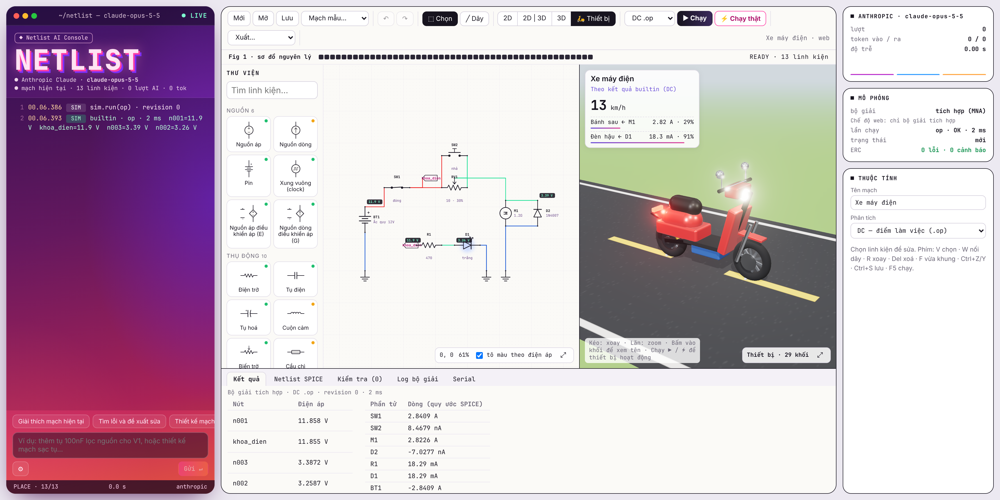
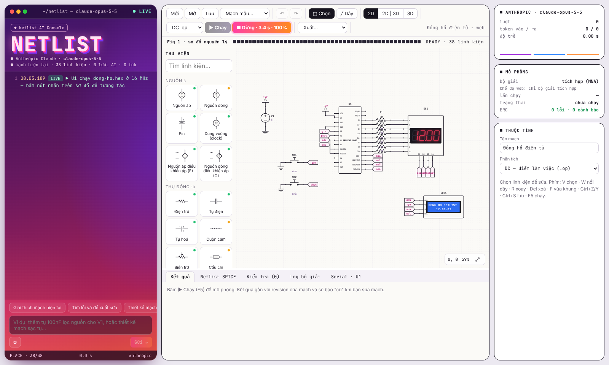
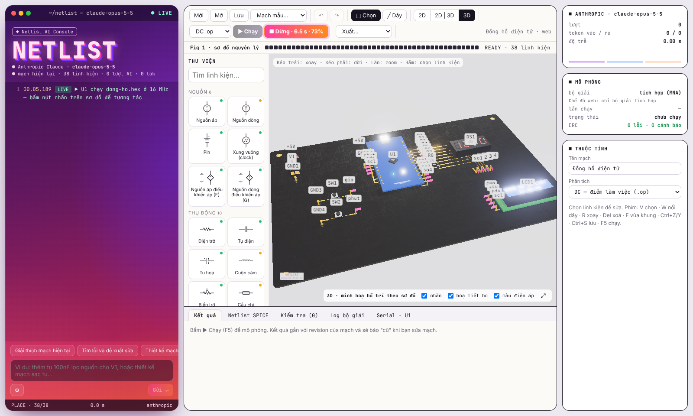
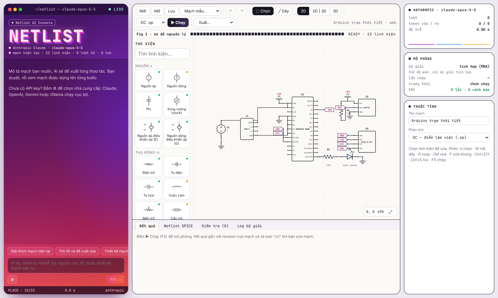
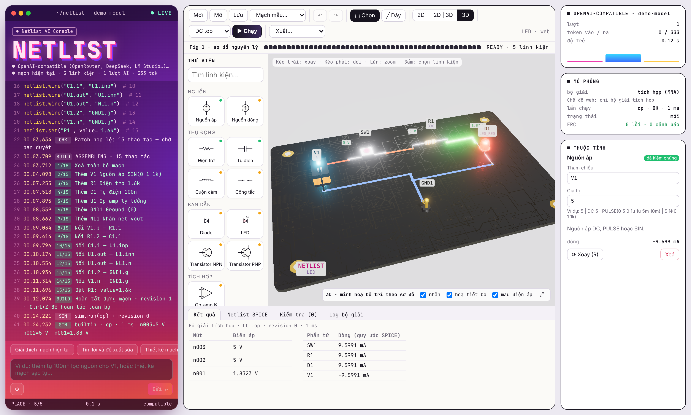

<div align="center">

# ⚡ Netlist

**Thiết kế mạch điện tử trực quan, mô phỏng như thật, làm việc cùng AI**

Kéo thả linh kiện · Mô phỏng SPICE · Chạy firmware Arduino · Xem 3D · AI vẽ mạch và dựng thiết bị 3D




</div>

> *English summary:* Netlist is a desktop app (Electron + React + TypeScript) for visual electronic circuit design. It has SPICE simulation (ngspice or a built-in MNA solver), real-time Arduino (ATmega328P) firmware emulation with 7-segment/LCD/OLED displays, a 3D board view, and an AI console. In the console, Claude, GPT, Gemini or local models propose circuit patches that you review before they are built step by step. The AI can also generate an animated 3D model of the target device (e.g. an e-scooter whose wheels spin with the motor current). UI language: Vietnamese.

## ✨ Tính năng

| | |
|---|---|
| 🖊️ **Vẽ sơ đồ nguyên lý** | Kéo thả 60 loại linh kiện, nối dây, nhãn net, junction, hoàn tác/làm lại, tự lưu bản nháp |
| 🔬 **Mô phỏng SPICE** | DC và transient bằng **ngspice** (khuyến nghị) hoặc **bộ giải tích hợp** chạy ngay không cần cài gì; waveform, ERC sau mô phỏng |
| 🤖 **AI thiết kế mạch** | Mô tả bằng lời → AI đề xuất patch (thêm linh kiện, nối dây, đặt giá trị) → bạn duyệt → mạch được dựng từng bước. Hỗ trợ Claude, OpenAI, Gemini, Ollama, mọi API tương thích OpenAI |
| ⚡ **Chạy thật** | Giả lập ATmega328P (Arduino Nano/Uno) chạy firmware `.hex`: LED 7 đoạn, LCD 1602 I²C, OLED SSD1306 hiện đúng nội dung; bấm nút nhấn bằng chuột |
| 🧊 **Xem 3D** | Bo mạch và linh kiện 3D đồng bộ với sơ đồ, LED phát sáng theo dòng, xuất GLB |
| 🛵 **Thiết bị 3D do AI dựng** | Thiết kế "động cơ xe máy điện" → AI dựng luôn chiếc xe 3D; bánh quay theo dòng động cơ, đèn sáng theo LED, đường chạy và đồng hồ km/h |
| 📦 **Xuất dữ liệu** | Dự án JSON, netlist SPICE `.cir`, BOM `.csv`, waveform `.csv`, PNG/SVG, mô hình `.glb` |

## 📸 Ảnh chụp

| Chạy thật: đồng hồ Arduino + LED 7 đoạn + LCD | Cùng mạch ở chế độ 3D |
|---|---|
|  |  |
| **Thư viện linh kiện** | **Bo mạch 3D, LED phát sáng** |
|  |  |

## 🚀 Bắt đầu

Cần **Node.js 20 trở lên**.

```bash
git clone https://github.com/qhsvn/QHNetlist.git
cd QHNetlist
npm install
npm run dev        # mở app desktop (Electron)
```

Trên Windows có thể bấm đúp `start.bat`: lần đầu nó tự `npm install` rồi mở app.

| Lệnh | Việc |
|---|---|
| `npm run dev` | App desktop Electron, tự nạp lại khi sửa mã |
| `npm run web` | Chỉ giao diện trong trình duyệt tại http://localhost:5173 (không có ngspice, không biên dịch .ino) |
| `npm test` | Chạy kiểm thử Vitest (phần ngspice tự bỏ qua nếu máy chưa cài) |
| `npm start` | Build rồi mở bản desktop |
| `npm run dist` | Đóng gói installer Windows bằng electron-builder (chưa kiểm thử trên máy sạch) |

### Cài ngspice (khuyến nghị)

Bộ giải tích hợp chạy được điện trở, tụ, cuộn cảm, pin, diode/LED/Zener, op-amp lý tưởng. BJT, MOSFET và IC thật (555, LM358, 7805...) cần ngspice:

1. Tải bản Windows 64-bit tại <https://ngspice.sourceforge.io/download.html> rồi giải nén để có `C:\Spice64\bin\ngspice_con.exe`. Trên Linux/macOS: `apt install ngspice` hoặc `brew install ngspice`.
2. Trong app, bấm ⚙ ở console AI → **Bộ giải ngspice** → **Kiểm tra**.

### Thiết lập AI

Bấm ⚙ ở console AI, chọn nhà cung cấp, dán API key của bạn và chọn model.

| Nhà cung cấp | Model mặc định |
|---|---|
| Anthropic Claude | `claude-opus-5-5` (có `claude-fable-5-1`, `claude-sonnet-5-5`, `claude-haiku-5-5`) |
| OpenAI | `gpt-5`, bấm **Tải danh sách** để lấy model mới |
| Google Gemini | `gemini-2.5-pro` |
| Ollama (cục bộ, offline) | `qwen2.5:7b` |
| Tương thích OpenAI | OpenRouter, DeepSeek, LM Studio, vLLM... (nhập Base URL) |

🔒 Mã nguồn **không chứa API key**. Ở bản desktop, key được mã hoá bằng kho bảo mật của hệ điều hành (Electron `safeStorage`) và chỉ dùng trong main process. Ở chế độ web, key nằm trong localStorage của trình duyệt.

## 🎮 Thử nhanh với mạch mẫu

Chọn trong menu **Mạch mẫu...**:

- **⏰ Đồng hồ điện tử**: bấm **⚡ Chạy thật** (F6). Arduino chạy firmware đồng hồ, LED 7 đoạn hiện giờ:phút, LCD hiện giờ:phút:giây. Bấm SW1/SW2 để chỉnh giờ, phút.
- **🛵 Xe máy điện**: mở tab **🛵 Thiết bị** (phím 4) rồi bấm ▶ Chạy. Xe chạy khoảng 13 km/h. Bấm ⚡ Chạy thật và giữ SW2 thì xe tăng tốc lên khoảng 43 km/h.
- NE555 nháy LED, nguồn 7805, MOSFET điều khiển động cơ PWM, Arduino + DHT22 + OLED, chia áp, RC, LED.

## 🤖 AI làm việc thế nào

1. Bạn gõ yêu cầu, ví dụ *"Tạo bộ lọc thông thấp RC fc = 1 kHz có tầng đệm op-amp"* hoặc *"Thiết kế động cơ xe máy điện và dựng chiếc xe 3D"*.
2. Console hiện phản hồi đang stream, số token, rồi danh sách thao tác dạng code (`netlist.place(...)`, `netlist.wire(...)`, `device.build(...)`).
3. Netlist kiểm tra patch trên bản sao (ref, chân, giá trị, revision). Patch sai bị từ chối và mạch giữ nguyên; bấm **Nhờ AI sửa** để AI tự sửa.
4. Bấm **▶ Dựng mạch** để xem linh kiện được đặt và nối dây từng bước. Cả lần dựng là một mục lịch sử, nên một lần Ctrl+Z hoàn tác hết.

AI chỉ đề xuất thao tác qua cùng command API với người dùng: không chạy lệnh, không ghi tệp, không chèn SPICE thô.

### Thiết bị 3D

AI ghép thiết bị từ khối cơ bản (`box`, `cylinder`, `sphere`, `cone`, `torus`, `capsule`, `wheel`) theo kích thước thật, rồi gắn chuyển động vào linh kiện trong mạch:

| Chuyển động | Ví dụ |
|---|---|
| `spin` | Bánh xe, cánh quạt quay theo dòng qua động cơ (có quán tính) |
| `glow` | Đèn pha, đèn hậu sáng theo LED/bóng đèn |
| `slide` / `swing` | Cửa cuốn, tay gạt, servo |
| `shake` | Còi, động cơ rung |

Giá trị lấy từ lần ▶ Chạy (DC, hoặc trung bình nửa sau của transient) hoặc trực tiếp từ ⚡ Chạy thật.

## ⚡ Chạy thật với Arduino

- Giả lập ATmega328P bằng [avr8js](https://github.com/wokwi/avr8js): timer, GPIO, ADC, UART, I²C.
- Mỗi lần chân đổi trạng thái, mạch được giải lại. Nhờ vậy LED sáng theo dòng thực tế và LED 7 đoạn quét đa hợp hiển thị đúng.
- LCD 1602 qua PCF8574 và OLED SSD1306 128×64 hiện đúng nội dung firmware ghi ra.
- Tab **Serial** hiện dữ liệu UART.
- Nạp firmware ở khung Thuộc tính của Nano/ATmega bằng một trong ba cách: **Nạp .hex**; **Biên dịch .ino** (bản desktop, cần `arduino-cli` và core `arduino:avr`); hoặc **Mẫu đồng hồ** (mã nguồn ở `firmware/clock/clock.c`).

## 🧩 Thư viện linh kiện (60 loại)

| Nhóm | Linh kiện |
|---|---|
| Nguồn | Nguồn áp DC/PULSE/SIN, nguồn dòng, pin (AA, 9V, CR2032, Li-ion, LiPo, ắc quy 12V, có nội trở), xung vuông/PWM, nguồn phụ thuộc E và G |
| Thụ động | Điện trở, tụ gốm, tụ hoá (có cực), cuộn cảm, biến trở, cầu chì, thạch anh, biến áp, quang trở LDR, nhiệt điện trở NTC |
| Cơ điện | Công tắc, nút nhấn, relay 5/12/24 V, bóng đèn, còi chip, loa, động cơ DC |
| Bán dẫn | Diode 1N4148/1N4007/1N5408, LED 5 màu, Zener 3V3–15V, Schottky 1N5819/1N5822/BAT54, cầu diode, BJT 2N3904/2N2222A/BC547B/TIP31C và 2N3906/2N2907A/BC557B/TIP32C, MOSFET 2N7000/BS170/IRF540N/IRLZ44N/IRF3205 và BS250/IRF9540/IRF4905, JFET 2N5457/J310/2N5460, SCR, opto PC817 |
| Tích hợp | Op-amp lý tưởng, op-amp thật LM358/LM324/LM741/TL072/NE5532/MCP6002 (có chân nguồn, bão hoà), so sánh LM393, NE555, ổn áp 7805/7809/7812/7833/AMS1117, LM317, cổng logic AND/NAND/OR/NOR/XOR/XNOR/NOT |
| Vi điều khiển & mô-đun | Arduino Nano, ESP32 DevKit, ATmega328P, DHT22, HC-SR04, OLED I²C, servo SG90 (chỉ hiển thị và nối dây) |
| Kết nối | Ground, nhãn net, ký hiệu nguồn (+5V, +3V3…), header 2/3/4 chân, cổng USB-C |

Chấm màu trên mỗi ô thư viện: xanh = đã kiểm chứng, cam = có mô hình, xám = chỉ hiển thị. Linh kiện ghi "cần ngspice" (BJT, MOSFET, IC thật) chỉ chạy được khi đã cài ngspice; các linh kiện thụ động, pin, diode/Zener/LED, cầu diode và nguồn phụ thuộc chạy được cả bằng bộ giải tích hợp. Mô hình IC là mô hình hành vi đơn giản hoá để học và thử nghiệm, không thay datasheet.

ERC sau khi chạy còn cảnh báo: tụ hoá phân cực ngược hoặc quá áp, cầu chì quá dòng, LED quá dòng, ổn áp thiếu điện áp vào, GPIO ESP32 nhận quá 3,6 V.

## ⌨️ Phím tắt

| Phím / chuột | Việc |
|---|---|
| Bấm linh kiện trong Thư viện, rồi bấm lên bản vẽ (hoặc kéo thả) | Đặt linh kiện |
| `V` | Công cụ chọn, kéo để di chuyển |
| `W` | Nối dây: bấm chân → bấm chân / dây đích. Bấm chỗ trống để tạo điểm gấp. Bấm lên dây có sẵn tạo junction |
| `R` | Xoay linh kiện đang chọn / đang đặt |
| `Del` | Xoá |
| Kéo nền, chuột giữa, Alt + kéo | Di chuyển khung nhìn |
| Lăn chuột | Phóng to / thu nhỏ |
| `F` | Vừa khung |
| `F5` | Chạy mô phỏng |
| `F6` | ⚡ Chạy thật |
| `3` | Đổi 2D → 2D \| 3D → 3D |
| `4` | Tab 🛵 Thiết bị |
| Ctrl+Z / Ctrl+Y / Ctrl+S / Ctrl+O | Hoàn tác / làm lại / lưu / mở |

Dây chéo nhau **không** tự nối; chỉ chân, junction và nhãn net cùng tên mới tạo kết nối.
Chân hở được đánh dấu vòng hồng. Sau khi chạy DC, dây được tô màu theo điện áp và mỗi net có thẻ giá trị; LED phát sáng minh hoạ theo dòng.

## 🗂️ Cấu trúc mã

```text
electron/     main process: cửa sổ, IPC allowlist, key mã hoá, chạy ngspice và arduino-cli; preload
src/core/     lõi TypeScript thuần, không phụ thuộc UI: thư viện linh kiện, document, kết nối,
              compiler SPICE, bộ giải MNA, ERC, patch AI, thiết bị 3D, xuất dữ liệu, mạch mẫu
src/sim/      giả lập AVR, thiết bị I²C (LCD1602, SSD1306), phiên chạy thật
src/ai/       adapter AI đa nhà cung cấp (streaming) và prompt
src/ui/       React: console AI, canvas SVG, 3D (Three.js), tab Thiết bị, thư viện, thuộc tính, kết quả
firmware/     firmware mẫu (C, avr-gcc)
tests/        Vitest: linh kiện, compiler, solver, patch, ngspice, firmware, thiết bị 3D
docs/         ảnh chụp và ghi chú kiến trúc (ADR)
```

## ✅ Kiểm thử

`npm test` cho 37/37 đạt trên Linux có ngspice 42. Các phép thử gồm:
- **Mạch cơ bản**: chia áp 2,5 V sai số < 1e-6 V; RC đạt 63,2 % tại t = τ; LED 5–12 mA.
- **IC**: 7805 ra 5,00 V; LM317 ra ~5,04 V; NE555 chu kỳ ≈ 7,2 ms; LM358 bão hoà đúng nguồn.
- **Bán dẫn**: Zener ghim áp; MOSFET IRLZ44N đóng tải; cổng NAND; động cơ PWM.
- **Arduino**: firmware đồng hồ chạy đúng giờ, quét đủ 4 chữ số, nút nhấn chỉnh phút.
- **Thiết bị 3D**: tốc độ xe theo tay ga và khoá điện; patch thiết bị sai bị từ chối.
- **AI**: patch sai ref, chân hoặc giá trị bị từ chối và mạch giữ nguyên.

## ⚠️ Giới hạn hiện tại

- 3D bo mạch là minh hoạ theo bố trí sơ đồ, chưa có breadboard hay PCB thật.
- Chạy thật chỉ hỗ trợ ATmega328P. ESP32 mới vẽ và nối dây được, và chạy thật chưa hỗ trợ BJT/MOSFET (dùng bộ giải tích hợp).
- Bộ giải tích hợp là xấp xỉ; ngspice là tham chiếu. Mô hình IC là mô hình hành vi đơn giản hoá để học và thử nghiệm, không thay datasheet.
- Thiết bị 3D ghép từ khối cơ bản nên mang tính minh hoạ.
- Mạch là bản thiết kế thử nghiệm: cẩn thận với điện lưới, pin Li-ion và công suất lớn.

## 📄 Giấy phép

Chưa chọn giấy phép (`"license": "UNLICENSED"` trong `package.json`). Khi công khai repo, hãy thêm tệp `LICENSE` (ví dụ MIT) và sửa trường này cho khớp.
